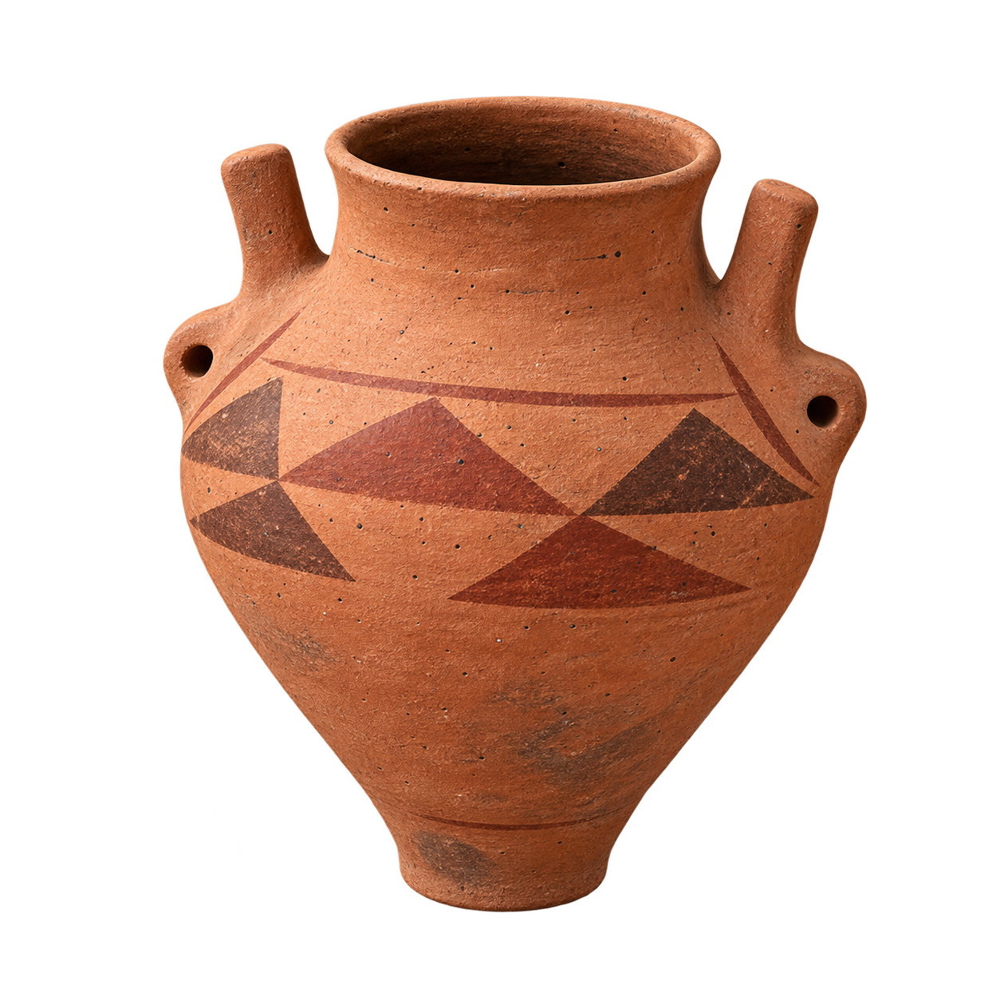
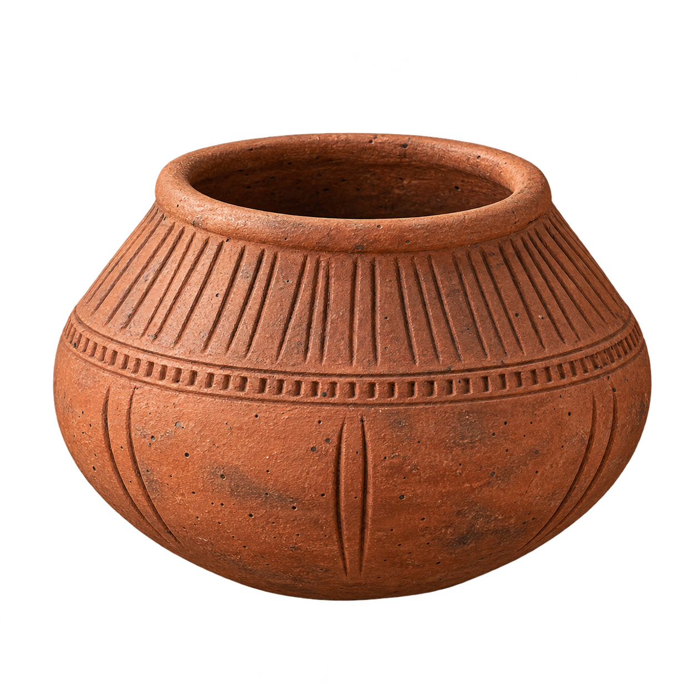
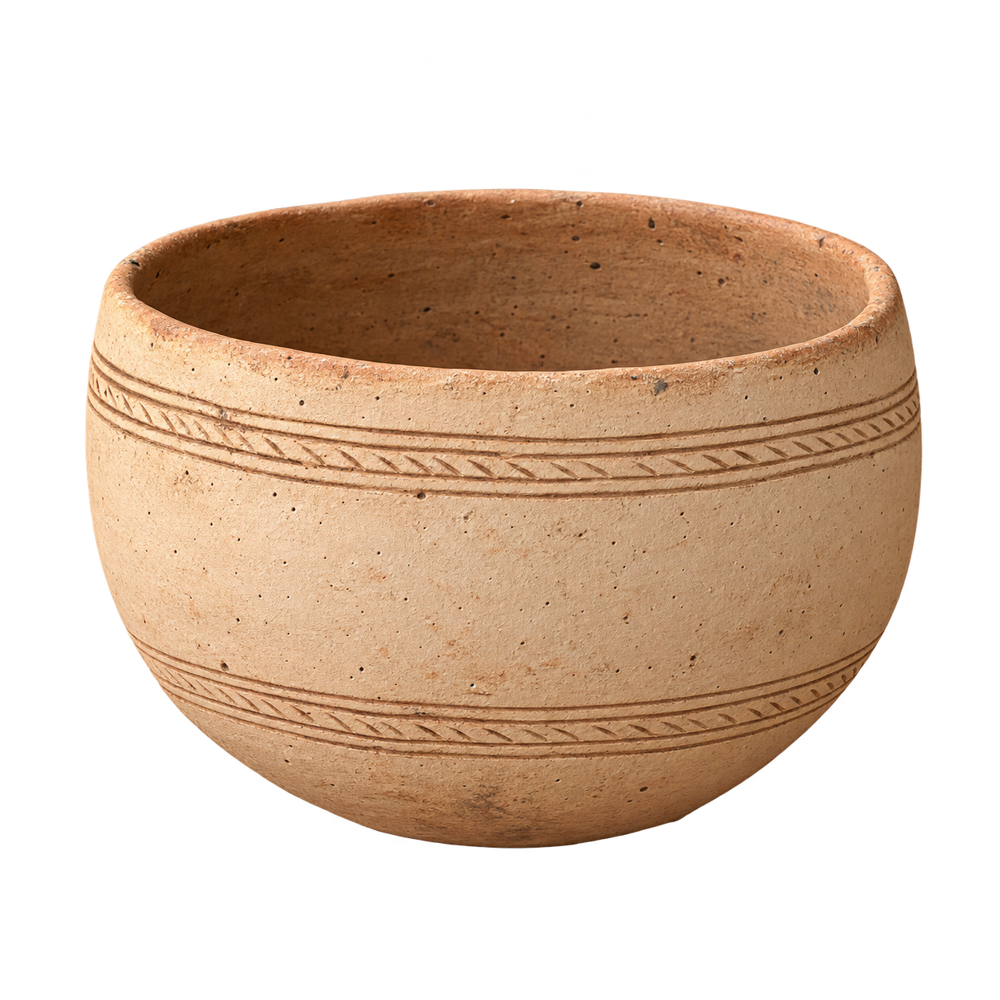
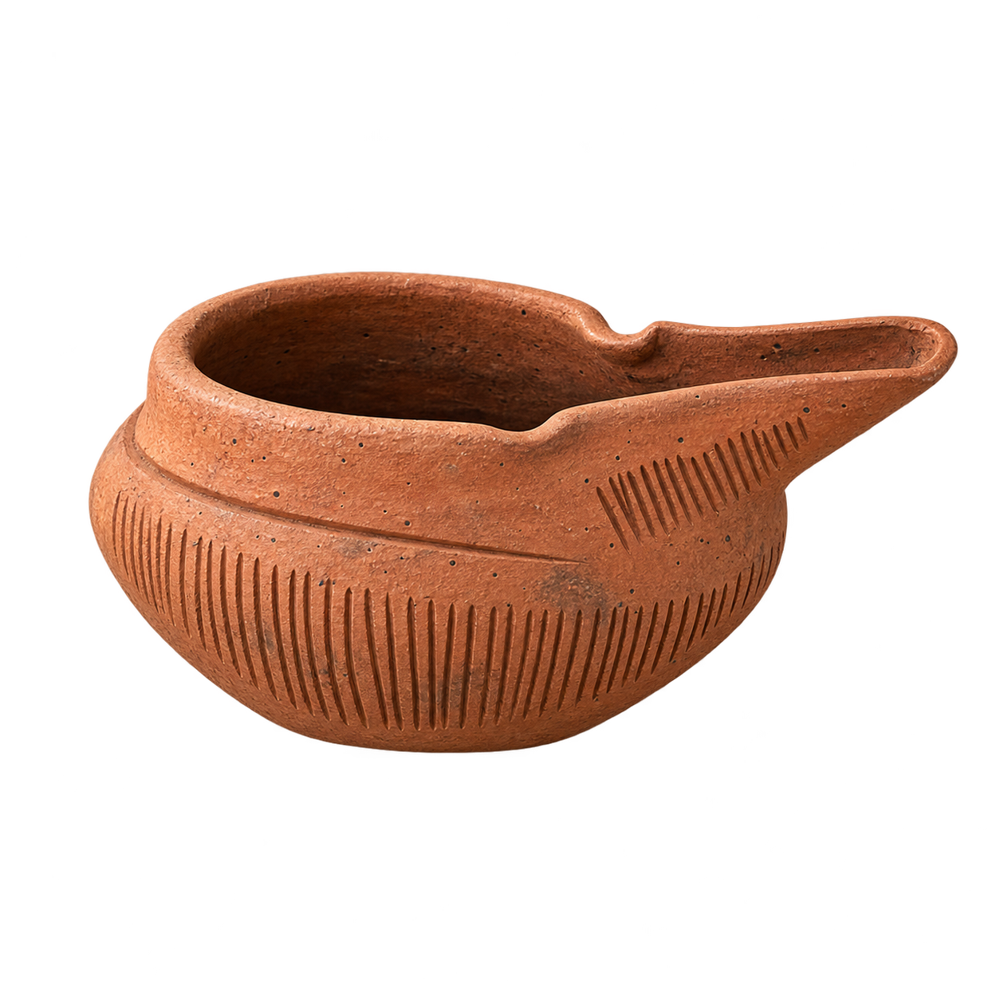
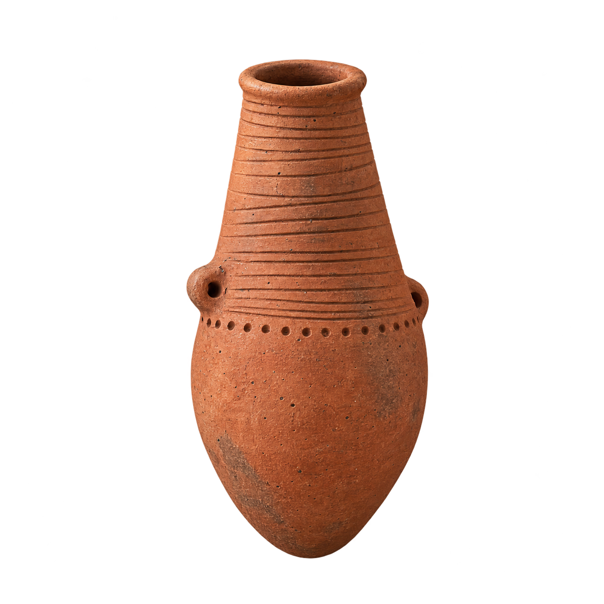
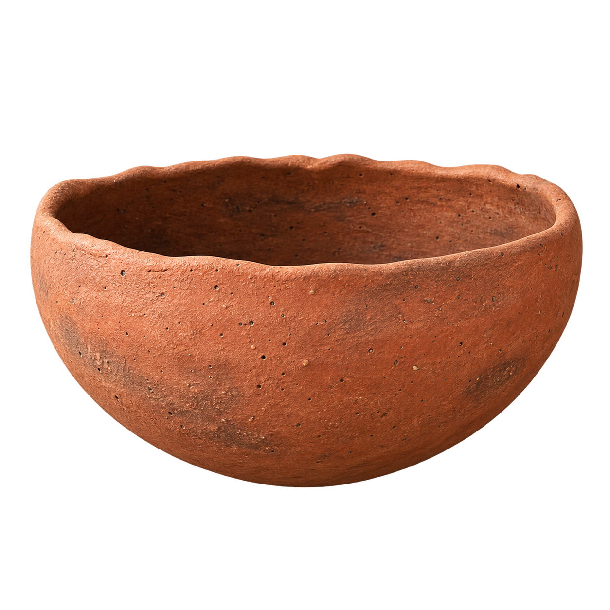
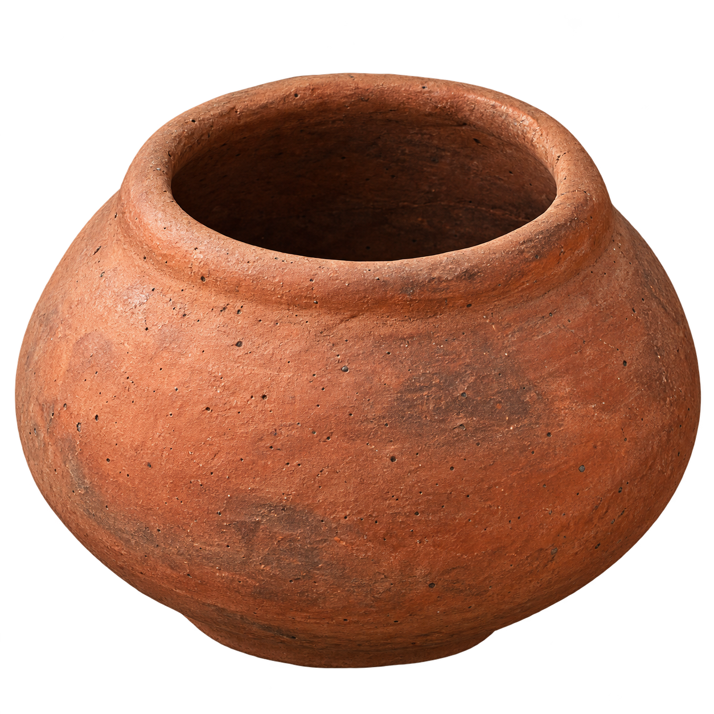
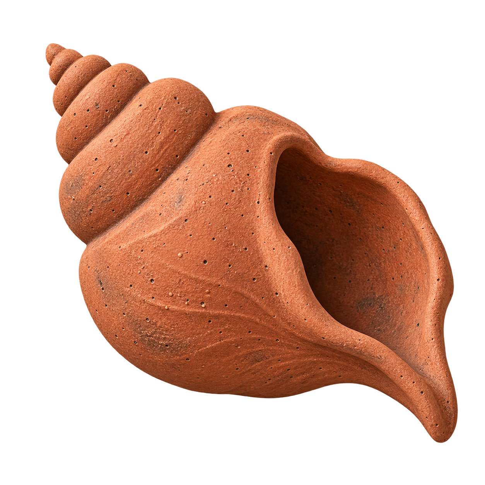

# Vasijas de Canarias — propuesta visual

[Descargar las siete imágenes en ZIP (11,1 MB)](https://github.com/crgarsan/mitomapa-canario/raw/refs/heads/propuesta-vasijas-20261022/Vasijas_Canarias_PNG_transparentes.zip)

Siete PNG de **1254 × 1254 píxeles**, con fondo transparente. Cada archivo lleva el nombre de su isla. Para ver una imagen a tamaño completo, selecciona su nombre o su miniatura.

| Gran Canaria | La Palma |
|:---:|:---:|
|  |  |
| **Lanzarote** | **Fuerteventura** |
|  |  |
| **Tenerife** | **La Gomera** |
|  |  |
| **El Hierro** | |
|  | |

## Propuesta complementaria para La Graciosa

[Ver y descargar el PNG de la caracola](https://raw.githubusercontent.com/crgarsan/mitomapa-canario/refs/heads/propuesta-vasijas-20261022/Propuesta_La_Graciosa/La_Graciosa_caracola.png)

Símbolo contemporáneo del vínculo de La Graciosa con el mar, con el mismo acabado de barro mate. Se entrega aparte para valoración; el ZIP de las siete vasijas conserva sus archivos originales.

## Referencias y alcance

Diseños originales inspirados en la [infografía del Gobierno de Canarias sobre las diferencias de la cerámica canario-amazigh](https://www3.gobiernodecanarias.org/medusa/ecoescuela/recursosdigitales/files/formidable/6/cd-03-0000079-infografia-simple-doble-formato-historia-tipos-de-ceramica-por-isla.pdf) y, para la forma completa de El Hierro, en la fotografía de vasijas facilitada por la persona usuaria.

Son recreaciones visuales para revisión, con pequeñas variaciones respecto a las referencias; no identifican piezas arqueológicas concretas. El ZIP de vasijas no incluye La Graciosa porque las fuentes aportadas no documentan una tipología propia; la caracola complementaria se identifica expresamente como símbolo contemporáneo.

Las [notas de fuentes y generación](Vasijas_Canarias/LEEME_FUENTES.txt) y el [manifiesto de imágenes](Vasijas_Canarias/MANIFIESTO.json) acompañan la entrega.

Esta rama contiene únicamente la propuesta de imágenes. La web, el ELPX y la rama `main` mantienen su contenido anterior.
